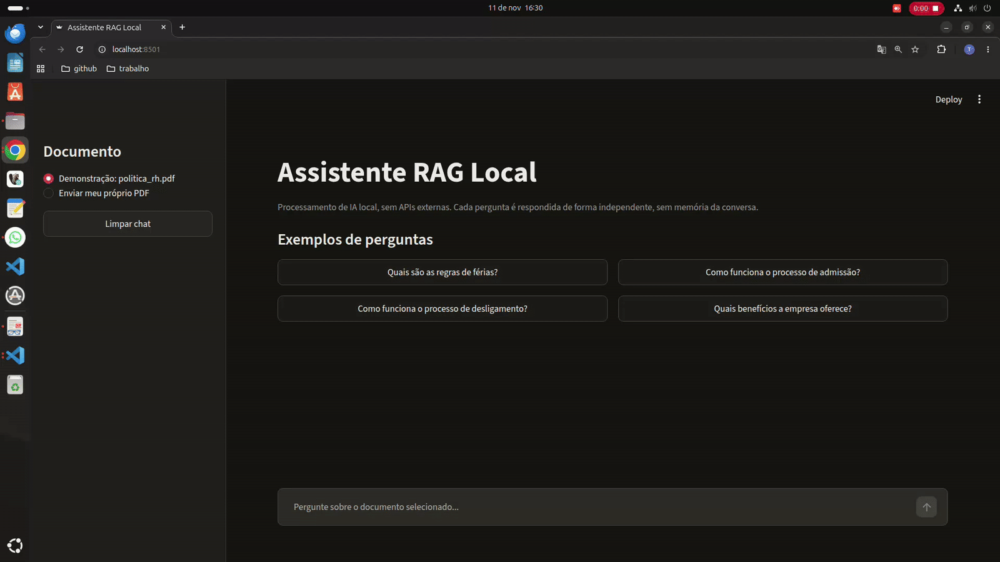

# Assistente RAG Local

Assistente de IA interno e local que responde perguntas com base nos documentos da empresa. Sem custo de API e sem enviar dados para serviços externos.

## Demonstração



---

# Como funciona

1. O PDF é carregado e dividido em trechos (chunks).
2. Cada trecho vira um vetor (embedding) e é indexado no FAISS.
3. A pergunta busca os trechos mais parecidos.
4. O LLM local responde usando só esses trechos como contexto.

## Stack

- Python 3.10+
- Streamlit (interface)
- LangChain + langchain-ollama
- FAISS (busca vetorial)
- pypdf (leitura de PDF)
- Ollama (execução dos modelos locais)

## Pré-requisitos

### 1. Instalar o Ollama

Baixe pelo link oficial: **https://ollama.com/download**

- Windows: baixe e execute o instalador `.exe`
- macOS: baixe o `.dmg` e arraste para Aplicativos
- Linux:

```bash
curl -fsSL https://ollama.com/install.sh | sh
```

Confirme a instalação:

```bash
ollama --version
```

### 2. Escolher os modelos locais

O projeto usa **dois modelos**: um de **chat** (gera a resposta) e um de **embedding** (indexa e busca nos PDFs). Escolha de acordo com o seu PC:

| Perfil do PC                    | Chat (LLM)        | Embedding            |
| ------------------------------- | ----------------- | -------------------- |
| Leve: até 8 GB de RAM, sem GPU | `llama3.2:1b`   | `nomic-embed-text` |
| Potente: 16 GB+ de RAM ou GPU   | `llama3.2` (3B) | `bge-m3`           |

- **Chat:** quanto maior o modelo, melhor a resposta, mas mais RAM/VRAM e mais lento.
- **Embedding:** `nomic-embed-text` é leve e rápido; `bge-m3` é multilíngue e busca melhor em português, mas é mais pesado.

Baixe os dois que você escolheu (exemplo com o perfil potente):

```bash
ollama pull llama3.2
ollama pull bge-m3
```

Outros modelos: https://ollama.com/library

Depois, **coloque os mesmos nomes** em `agent/config.py`:

```python
LLM_MODEL = "llama3.2:latest"
EMBEDDING_MODEL = "bge-m3:latest"
```

> **Importante:** se você trocar o modelo de embedding, reinicie o app. Vetores de modelos diferentes não são compatíveis.

Verifique se baixaram:

```bash
ollama list
```

Se o Ollama não estiver rodando em segundo plano, inicie com:

```bash
ollama serve
```

## Instalação do projeto

```bash
# Clonar o repositório
git clone "https://github.com/devthayron/agente-ia-rag.git"
cd agente-ia-rag

# Criar e ativar o ambiente virtual
python -m venv venv

# Windows
venv\Scripts\activate
# macOS / Linux
source venv/bin/activate

# Instalar dependências
pip install -r requirements.txt
```

## Executando

```bash
streamlit run app.py
```

Abra http://localhost:8501 no navegador.

- Sem upload: usa o documento padrão `politica_rh.pdf` (dados fictício).
- Com upload: indexa o PDF enviado e responde com base nele.

## Estrutura do projeto

```
.
├── app.py                  # Interface Streamlit
├── agent/
│   ├── config.py           # Config do agente (modelos, chunks)
│   └── rag.py              # Pipeline RAG
├── data/
│   └── politica_rh.pdf
│
├── requirements.txt
└── README.md
```

## Problemas comuns

| Problema                              | Causa provável                 | Solução                                  |
| ------------------------------------- | ------------------------------- | ------------------------------------------ |
| `Connection refused` na porta 11434 | Ollama não está rodando       | Execute `ollama serve`                   |
| `model not found`                   | Modelo não baixado             | Execute `ollama pull <modelo>`           |
| Respostas lentas                      | Modelo grande para sua máquina | Use um modelo menor (ex.: `llama3.2:1b`) |
| PDF escaneado sem resposta            | PDF é imagem, sem texto        | Faça OCR antes de enviar                  |

## Autor

**Thayron Higlânder**

LinkedIn: [https://www.linkedin.com/in/thayron-higlander](https://www.linkedin.com/in/thayron-higlander)

## Licença

Este projeto está sob a licença [MIT](LICENSE).
